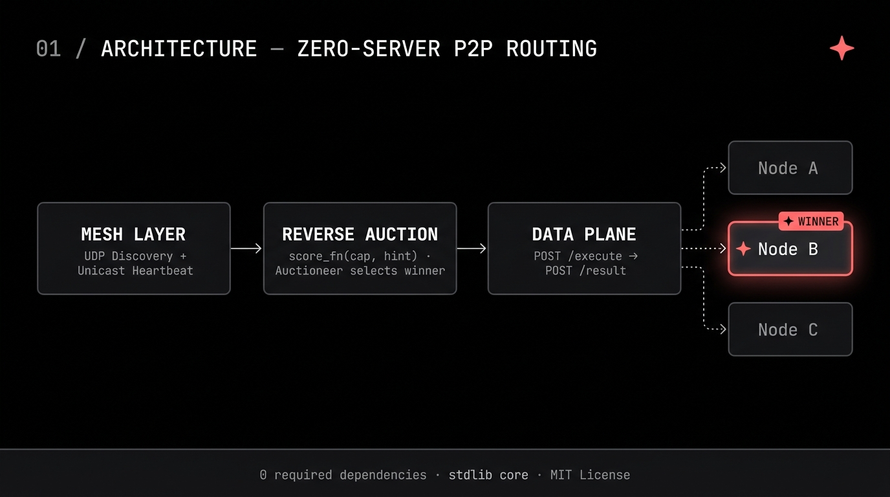

<p align="center">
  
</p>

<p align="center">
  <a href="LICENSE"></a>
  
  
</p>

---

**Drift** is a lightweight, serverless peer-to-peer task routing framework built for local AI hardware. Machines discover each other over LAN or Tailscale/WireGuard, run a fast reverse auction on every task, and execute work on whichever node fits best — with **no central broker, no cloud dependency, and zero required runtime packages**.

Built by **Vorlabs** as the distributed execution backbone of **Valori** — and the foundation for the upcoming **VorAgents**.

---

## 01 / Architecture

<p align="center">
  
</p>

1. **Mesh Layer (`drift.mesh.MeshNode`)** — UDP discovery beacons (LAN broadcast or static seeds for Tailscale/WireGuard) + unicast control messages + peer table.
2. **Reverse Auction (`drift.auction.Auctioneer` & `drift.scoring`)** — Any node opens an auction; capable peers score the task (`score_fn(cap, hint)`) against CPU, RAM, cached GPU load, and active tasks (`0.86 µs` per `default_scorer` evaluation); highest bid wins.
3. **Data Plane (`drift.dataplane` & `drift.node.Node`)** — HTTP `POST /execute` and `POST /result` with optional HMAC/Fernet authentication (`drift.security`).

---

## 02 / Installation

```bash
pip install git+https://github.com/becksanswerr/drift.git
```

Optional extras when you want live hardware telemetry, encrypted mesh traffic, or the terminal dashboard:

```bash
pip install "vorlabs-drift[metrics,secure,gpu,tui] @ git+https://github.com/becksanswerr/drift.git"
```

| Extra | Package | Purpose |
|---|---|---|
| `metrics` | `psutil>=5.9` | Live CPU / RAM sampling in bids |
| `gpu` | `GPUtil>=1.4` | Cached background NVIDIA GPU load |
| `secure` | `cryptography>=42.0` | Encrypted / authenticated mesh traffic |
| `tui` | `rich>=13.0` | Terminal swarm dashboard |

---

## 03 / Quick Start (`drift.Node`)

Every machine runs the same `Node` — worker and client in one process, no separate server:

```python
from drift import Node

node = Node(name="workshop", secret="shared-cluster-secret")

@node.capability("summarise", cost=2)
def summarise(payload):
    return {"text": payload["text"][:280]}

node.start()

# Runs locally or on whichever peer wins the reverse auction
result = node.call("summarise", {"text": "Long document..."})
print(result)

node.run_forever()
```

---

## 04 / Embedding the Mesh & Auctioneer (How Valori Uses Drift)

If your application already has its own HTTP server (like **Valori**'s FastAPI runtime), you can embed `MeshNode` and `Auctioneer` directly without `drift.Node`:

```python
from drift.auction import Auctioneer
from drift.mesh import MeshNode

mesh = MeshNode(
    name="node-a",
    http_port=8700,
    secret="shared-cluster-secret",
    on_log=lambda message, level="info", source="drift": print(f"[{source}:{level}] {message}"),
)

def can_serve(cap: str) -> bool:
    return cap in {"llm_worker", "embeddings"}

def score_fn(cap: str, hint: dict) -> int:
    # Return <= 0 to sit out an auction
    return 85 if cap == "llm_worker" else 50

auctioneer = Auctioneer(mesh, can_serve=can_serve, score_fn=score_fn)
mesh.start()
```

Callback signatures (`can_serve(cap)`, `score_fn(cap, hint)`, `log(message, level=..., source=...)`) are validated at wiring time so misconfigured hosts fail loudly instead of silently dropping bids.

---

## 05 / Powering Valori

Inside **Valori**, multiple local machines (workstations, laptops, GPU nodes over LAN or Tailscale) form a single self-routing pool:

- **Zero external leakage:** Prompts, memory, and tool calls stay on hardware you own.
- **Locality-aware routing:** `drift.llm` and `score_fn(cap, hint)` favor nodes that already have the requested model warm in VRAM.
- **Measured footprint:** `0` required runtime dependencies (pure Python stdlib core), `default_scorer` evaluates in `~0.86 µs/bid` (100,000 calls in `85.74 ms` on local Python 3.11), verified by `85` unit & contract tests.

---

## 06 / Examples & Paper

- [`examples/01_hello_capability.py`](examples/01_hello_capability.py) — Single capability node
- [`examples/02_ask_the_hive.py`](examples/02_ask_the_hive.py) — Multi-node capability routing
- [`examples/03_llm_router.py`](examples/03_llm_router.py) — Warm-VRAM LLM routing
- [`examples/04_custom_scoring.py`](examples/04_custom_scoring.py) — Custom `ScoreContext` bidder
- [`docs/paper/drift.md`](docs/paper/drift.md) — Design notes & Cognitive Budget model

---

## License

MIT — see [LICENSE](LICENSE). Built by [Vorlabs](https://vorlabs.co).
