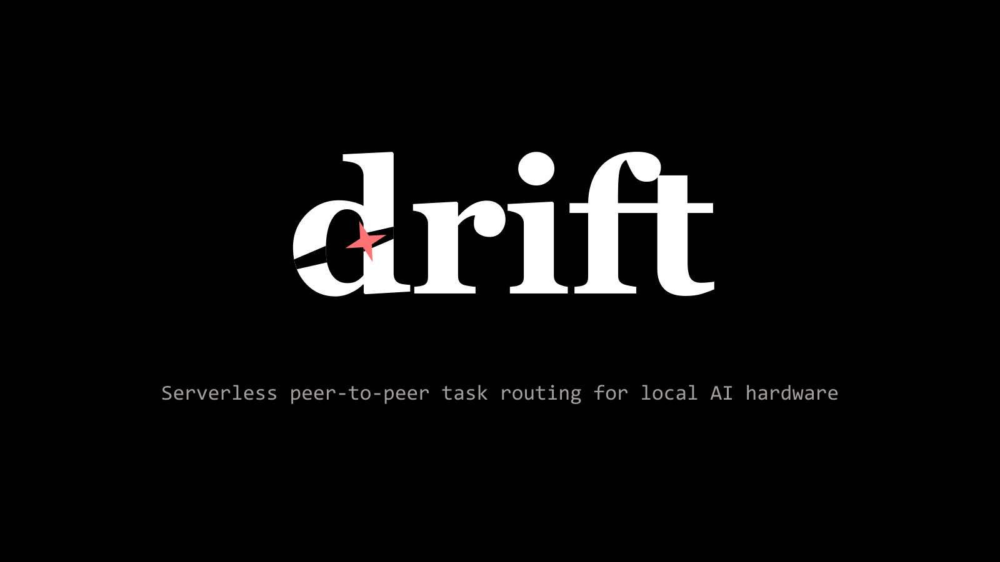

# 🌊 Drift Framework

> A lightweight, decentralized peer-to-peer framework for distributed AI workloads.



Drift is a modern P2P framework built for the era of AI. It allows nodes to discover each other, form a mesh network, and dynamically bid on computational tasks using a reverse-auction mechanism. 

It powers autonomous agent networks by providing a reliable **Data Plane** and an intelligent **Control Plane**.

## 🚀 Features

- **Hybrid Transport**: UDP for fast local discovery, Unicast for reliable control messages, and HTTP for high-throughput data transfer.
- **Auction-Based Task Routing**: Nodes bid on tasks based on their capabilities, available context window, and real-time load.
- **Pluggable Discovery**: Support for local broadcast and static seeding (Tailscale/WireGuard compatible).
- **Secure by Default**: AES-GCM (via Fernet) encryption and HMAC authentication for all mesh traffic.
- **Rich TUI & CLI**: Built-in terminal user interface and command-line tools for monitoring the swarm.

## 📦 Installation

```bash
pip install drift-framework
```
*(Note: Not yet on PyPI. Clone and install locally via `pip install -e .`)*

## 🧠 The Architecture

Drift separates concerns into three distinct layers:

1. **Mesh Layer (`mesh.py`)**: Handles node discovery, heartbeat, and encrypted P2P communication.
2. **Auction Layer (`auction.py`)**: Manages the bidding process, evaluating node capabilities and selecting the best worker for a given task.
3. **Data Plane (`dataplane.py`)**: Orchestrates the actual execution of tasks, payload transfer, and result collection.


## 🛠️ Quick Start

### 1. Start a Node

```python
import asyncio
from drift.node import DriftNode
from drift.security import SecurityConfig

async def main():
    sec_cfg = SecurityConfig(shared_secret=b"my-super-secret-key-12345678901=")
    
    # Initialize a node with capabilities
    node = DriftNode(
        port=8000, 
        security_config=sec_cfg,
        capabilities={"llm": True, "gpu": True, "models": ["gpt-4", "claude-3"]}
    )
    
    await node.start()
    print("Node is running! Press Ctrl+C to stop.")
    
    # Keep alive
    while True:
        await asyncio.sleep(1)

if __name__ == "__main__":
    asyncio.run(main())
```

### 2. Request a Task

```python
import asyncio
from drift.dataplane import DriftDataPlane
from drift.security import SecurityConfig
from drift.mesh import DriftMesh

async def submit_task():
    sec_cfg = SecurityConfig(shared_secret=b"my-super-secret-key-12345678901=")
    mesh = DriftMesh(port=8001, security_config=sec_cfg)
    await mesh.start()
    
    dataplane = DriftDataPlane(mesh)
    
    # Define task requirements
    requirements = {"capability": "llm", "model": "gpt-4"}
    payload = {"prompt": "Explain decentralized AI in 3 sentences."}
    
    print("Submitting task to the swarm...")
    result = await dataplane.execute_task(
        task_type="llm_inference",
        payload=payload,
        requirements=requirements
    )
    
    print("Result received:", result)
    await mesh.stop()

if __name__ == "__main__":
    asyncio.run(submit_task())
```

## 📁 Repository Structure

```
drift/
├── src/
│   └── drift/
│       ├── __init__.py
│       ├── mesh.py        # Discovery & P2P Networking
│       ├── auction.py     # Bidding & Negotiation
│       ├── dataplane.py   # Task Execution
│       ├── scoring.py     # Bid Evaluation Logic
│       ├── security.py    # Encryption & Auth
│       ├── llm.py         # AI-specific utilities
│       ├── node.py        # High-level Node Abstraction
│       ├── cli.py         # Command-line Interface
│       └── tui.py         # Terminal User Interface
├── tests/                 # Comprehensive test suite
├── examples/              # Usage examples
└── docs/                  # Documentation and visuals
```

## 🤝 Contributing

Contributions are welcome! Please feel free to submit a Pull Request.

## 📄 License

This project is licensed under the MIT License.
